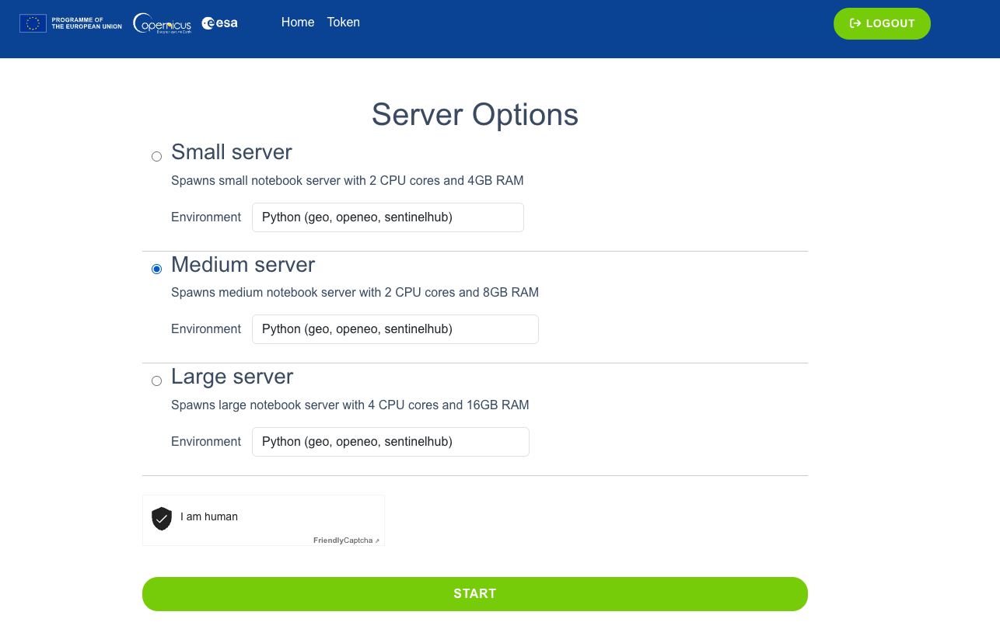
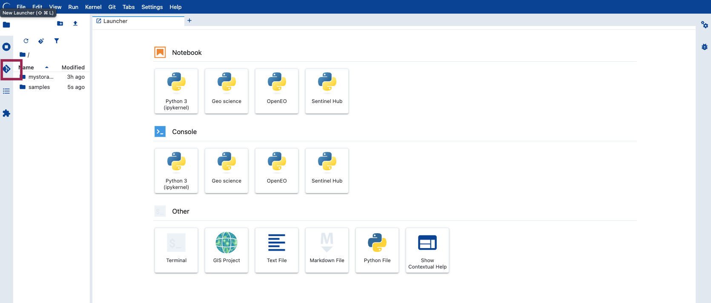
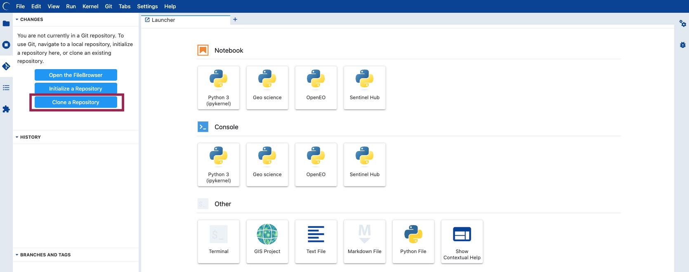
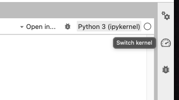

# APEx: Ready-to-Use Earth Observation Solutions @ 12th CASSINI Hackathon

# APEx: Ready-to-use Earth Observation Solutions at the 12th CASSINI Hackathon

Welcome to the [APEx](https://apex.esa.int/) repository for the [12th CASSINI Hackathon - EU Space for Peace and Resilience](https://www.cassini.eu/hackathons/)! 

We're inviting participants to explore the available resources in the APEx Algorithm Catalogue!

The [APEx Algorithm Catalogue](https://algorithm-catalogue.apex.esa.int/) hosts over 30 algorithms on the [Copernicus Data Space Ecosystem](https://dataspace.copernicus.eu/) (CDSE), enabling applications such as detecting forest disturbances in border areas, monitoring agricultural changes due to conflict, and mapping infrastructure such as photovoltaic farms.

This Hackathon is a great opportunity to expand your skills, contribute to the Earth observation community within the EU Space for Peace and Resilience topics. Moreover, we would be glad to have your feedback and help us find more applications for all the algorithms hosted in this great resource!

## Key Stages & Events

### Stage 1: Big Ideas Campaign (2–13 November)
Get inspired and sharpen your skills before the hackathon weekend!
- **Introductory Session Recording**: [Watch on Vimeo](https://vimeo.com/1243302084?share=copy&fl=sv&fe=ci)
- **APEx Hands-On Workshop**: **12 November | 14:00 – 15:00 CET**  
  Explore how EO algorithms directly address CASSINI challenge statements.  
  👉 [Register for the Teams session](https://events.teams.microsoft.com/event/391313b8-84f8-46cc-aba6-57489306818a@78358c89-6d86-4eeb-bee1-9c52711fc036?source=copyLinkLegacyShareLinkDialog)

### Stage 2: Learning & Development (Hackathon Weekend)
Explore the **[APEx 101 Notebook](./notebooks/APEx_101.ipynb)** to learn how to search, configure, and execute algorithms using Python and openEO[cite: 1, 4].

---

## Environment Setup

The recommended primary environment is **CDSE JupyterLab**. Alternatively, you can run the notebooks locally or in your preferred IDE using Conda.

### Option A: Copernicus Data Space JupyterLab (Recommended)

1. **Log in**: Sign in to [CDSE JupyterLab](https://jupyterhub.dataspace.copernicus.eu/). New users can [register here](https://documentation.dataspace.copernicus.eu/Registration.html).
2. **Server size**: Select a **Medium server** (recommended for processing time-series and large spatial extents) and click **Start**.
   
   <p align="center"></p>

3. **Open Git Tab**: On the left navigation bar, open the Git tab.
   
   <p align="center"></p>

4. **Clone the Repo**: Paste the repository URL to clone it directly into your workspace.
   
   <p align="center"></p>

5. **Set up the Conda Kernel**: Open a terminal inside JupyterLab and run:
   ```bash
   # Create the environment from environment.yml
   conda env create -f environment.yml

   # Activate and register kernel for Jupyter
   conda activate apex_env
   python -m ipykernel install --user --name apex_env --display-name "Python (APEx)"

6. **Select Kernel**: Open a`pex_101.ipynb`, click the kernel selector in the top-right corner, and choose Python (APEx).

    <p align="center"></p>

### Option B: Local set up

You can also clone the repo on your local machine and run the following steps in bash:

```
git clone <https://github.com/ESA-APEx/apex_events.git>
cd <REPO-FOLDER>
conda env create -f environment.yml
conda activate apex_env
jupyter lab
```

## How to Participate

This Hackathon will take place simultaneously on site across 10 different locations from 27-29 November 2026.

<div align="center">

| Country | Link | Country | Link |
| :---: | :--- | :---: | :--- |
| 🇧🇬 **Bulgaria** | [Bulgaria](https://www.cassini.eu/hackathons/bulgaria) | 🇮🇹 **Italy** | [Italy](https://www.cassini.eu/hackathons/italy) |
| 🇨🇿 **Czech Republic** | [Czech Republic](https://www.cassini.eu/hackathons/czechrepublic) | 🇱🇹 **Lithuania** | [Lithuania](https://www.cassini.eu/hackathons/lithuania) |
| 🇫🇮 **Finland** | [Finland](https://www.cassini.eu/hackathons/Finland) | 🇵🇱 **Poland** | [Poland](https://www.cassini.eu/hackathons/poland) |
| 🇩🇪 **Germany** | [Germany](https://www.cassini.eu/hackathons/germany) | 🇷🇴 **Romania** | [Romania](http://cassini.eu/hackathons/romania) |
| 🇮🇪 **Ireland** | [Ireland](https://www.cassini.eu/hackathons/ireland) | 🇺🇦 **Ukraine** | [Ukraine](https://www.cassini.eu/hackathons/ukraine) |

</div>


**No space experience needed**; choose a challenge, use EU space tech, and compete for cash prizes up to 9,000€ (1st: 5,000€, 2nd: 3,000€, 3rd: 1,000€) plus 6 months of mentoring. Be sure to review the [Rules of Contest](https://www.cassini.eu/hackathons/sites/default/files/2024-09/Rules%20of%20Contest%20-%20Cassini%20Hackathons%20Prize%20after%20Corrigendum%201.pdf) before applying.


<div align="center"> `Happy apex coding!` 🛰️🚀 </div>